<!-- ================================================================= -->
<!-- HITESH CHUGH | PREMIUM GITHUB PROFILE README                      -->
<!-- PALETTE: #10070C (midnight) | #190B12 (dark wine) | #451126 (wine) -->
<!--          #701A3D (accent)   | #C77B9B (rose)      | #E5B5C7 (pale) -->
<!--          #F8F0F3 (ivory)                                         -->
<!-- ================================================================= -->

<div align="center">

<!-- 01. ANIMATED HERO BANNER -->


</div>

<br />

<!-- 02. AUTHENTIC INTRODUCTION & SYSTEM IDENTITY -->
### ◈ Executive Overview

```yaml
identity:
  name: Hitesh Chugh
  position: AI/ML Engineer · Full-Stack Systems Developer
  academic: Bachelor of Engineering (CSE — Artificial Intelligence & Machine Learning)
  institution: Chandigarh University
  academic_standing: 3rd Year · CGPA 8.45 / 10.0
  core_focus: Deep Learning, Predictive Modeling & Cloud-Native Architectures
```

> **"Engineering intelligent algorithms that bridge rigorous machine learning with production-grade full-stack architectures."**

I am a Computer Science Engineer specializing in **Artificial Intelligence & Machine Learning** at **Chandigarh University**. My engineering work centers on building predictive systems, computer vision pipelines, and resilient backend services that solve real-world problems. Whether training neural models or architecting containerized web platforms, I focus on clean software architecture, computational efficiency, and purposeful design.

<p align="center">
  
</p>

### ◈ Academic & Technical Credentials

<table>
  <tr>
    <td width="33%" valign="top">
      <h4>🎓 Education &amp; Status</h4>
      <ul>
        <li><b>B.E. Computer Science &amp; Engineering</b></li>
        <li>Specialization: <i>AI &amp; Machine Learning</i></li>
        <li><b>Chandigarh University</b></li>
        <li>Cumulative CGPA: <b>8.45 / 10.0</b></li>
        <li>Cohort: <i>3rd Year Undergraduate</i></li>
      </ul>
    </td>
    <td width="33%" valign="top">
      <h4>🧠 Applied Focus Areas</h4>
      <ul>
        <li><b>Predictive Analytics:</b> Time-series &amp; regression modeling</li>
        <li><b>Computer Vision:</b> CNNs &amp; character recognition</li>
        <li><b>NLP:</b> Misinformation detection &amp; text classification</li>
        <li><b>Distributed Web:</b> MERN &amp; TypeScript architectures</li>
      </ul>
    </td>
    <td width="33%" valign="top">
      <h4>⚙️ Engineering Standards</h4>
      <ul>
        <li><b>Containerization:</b> Docker microservices</li>
        <li><b>CI/CD Pipelines:</b> GitHub Actions workflows</li>
        <li><b>API Design:</b> RESTful architectures &amp; load testing</li>
        <li><b>Quality Control:</b> Modular MVC structure &amp; OOP</li>
      </ul>
    </td>
  </tr>
</table>

<p align="center">
  
</p>

<!-- 03. SELECTED REAL PROJECTS -->
### ◈ Selected Real Projects

A curated showcase of verified production systems and machine learning implementations built with actual repositories and working deployments.

<div align="center">

<table width="100%">
  <tr>
    <td width="50%" valign="top">
      <a href="https://github.com/HiteshChugh-2006/SocialHub-AI">
        
      </a>
      <p align="left">
        <b>SocialHub AI — Enterprise Content Engine</b><br />
        <i>"Create Once. Publish Everywhere."</i> Multi-platform social management engine with AI-assisted post synthesis and automated distribution pipelines.<br />
        <b>Stack:</b> React · Node.js · Express · MongoDB · REST APIs<br />
        🌐 <b>Live Platform:</b> <a href="https://social-hub-ai-sigma.vercel.app">social-hub-ai-sigma.vercel.app</a>
      </p>
    </td>
    <td width="50%" valign="top">
      <a href="https://github.com/HiteshChugh-2006/pravriddhi">
        
      </a>
      <p align="left">
        <b>Pravriddhi — Workforce Intelligence</b><br />
        Comprehensive full-stack talent intelligence platform delivering automated skill-gap analysis, adaptive career progression roadmaps, and career matching simulations.<br />
        <b>Stack:</b> TypeScript · React · Node.js · Machine Intelligence
      </p>
    </td>
  </tr>
  <tr>
    <td width="50%" valign="top">
      <a href="https://github.com/HiteshChugh-2006/CodeAlpha_Sales-Forecasting-BI-System">
        
      </a>
      <p align="left">
        <b>Adaptive ML Sales Forecasting &amp; BI Engine</b><br />
        Time-series forecasting and business intelligence dashboard engineered to ingest transactional datasets, isolate seasonal trends, and model projected inventory demand.<br />
        <b>Stack:</b> Python · scikit-learn · Pandas · NumPy · BI Analytics
      </p>
    </td>
    <td width="50%" valign="top">
      <a href="https://github.com/HiteshChugh-2006/CodeAlpha_AI-Handwritten-Character-Recognition-System">
        
      </a>
      <p align="left">
        <b>AI Handwritten Character Recognition System</b><br />
        Computer vision pipeline employing deep Convolutional Neural Networks (CNNs) for high-accuracy image segmentation and real-time character recognition.<br />
        <b>Stack:</b> Python · TensorFlow · Keras · OpenCV · CNNs
      </p>
    </td>
  </tr>
  <tr>
    <td width="50%" valign="top">
      <a href="https://github.com/HiteshChugh-2006/CodeAlpha_Fake-News-Detection-System">
        
      </a>
      <p align="left">
        <b>NLP Fake News &amp; Misinformation Detector</b><br />
        Natural Language Processing classifier parsing lexical and semantic signals to detect fabricated digital journalism and misinformation.<br />
        <b>Stack:</b> Python · NLTK · scikit-learn · TF-IDF Vectorization
      </p>
    </td>
    <td width="50%" valign="top">
      <a href="https://github.com/HiteshChugh-2006/Fullstack-CI-CD-Docker-App">
        
      </a>
      <p align="left">
        <b>Fullstack Dockerized Microservices &amp; CI/CD</b><br />
        End-to-end containerized web service architecture integrated with automated GitHub Actions workflows, multi-stage Docker builds, and testing pipelines.<br />
        <b>Stack:</b> Docker · GitHub Actions · Node.js · DevOps
      </p>
    </td>
  </tr>
</table>

</div>

<p align="center">
  
</p>

<!-- 04. SKILLS GROUPED BY CATEGORY (BURGUNDY THEME) -->
### ◈ Verified Technical Stack

<div align="center">

#### Core Languages &amp; Computing Logic
<p>
  
  
  
  
  
  
</p>

#### Artificial Intelligence, Machine Learning &amp; Data Science
<p>
  
  
  
  
  
  
</p>

#### Frontend &amp; User Interface Architecture
<p>
  
  
  
  
  
</p>

#### Backend, Databases &amp; Cloud Infrastructure
<p>
  
  
  
  
  
  
</p>

#### Developer Tooling &amp; Workflow
<p>
  
  
  
  
  
</p>

</div>

<p align="center">
  
</p>

<!-- 05. CONTRIBUTION HEATMAP & DYNAMIC PIPELINE -->
### ◈ Contribution Heatmap &amp; Dynamic Activity

<div align="center">

<p align="center">
  
</p>

<sub><i>Live automated contribution telemetry compiled daily via GitHub Actions.</i></sub>

</div>

<p align="center">
  
</p>

<!-- 06. GITHUB METRICS & TELEMETRY (BURGUNDY THEME) -->
### ◈ GitHub Metrics &amp; Diagnostics

<div align="center">

<table border="0" align="center" width="100%">
  <tr>
    <td align="center" width="50%" valign="top">
      
    </td>
    <td align="center" width="50%" valign="top">
      
    </td>
  </tr>
  <tr>
    <td align="center" colspan="2" valign="top">
      <br />
      
    </td>
  </tr>
</table>

</div>

<p align="center">
  
</p>

<!-- 07. VERIFIED PROFESSIONAL PROFILES & CONTACT -->
### ◈ Connect &amp; Collaborate

<div align="center">

<p>
  <a href="https://www.linkedin.com/in/hiteshchugh/">
    
  </a>
  &nbsp;
  <a href="mailto:hiteshchugh.work@gmail.com">
    
  </a>
  &nbsp;
  <a href="https://github.com/HiteshChugh-2006">
    
  </a>
</p>

<sub><i>Always open to discussions regarding AI/ML research collaborations, software engineering roles, and innovative open-source architectures.</i></sub>

<br /><br />

<!-- 08. MINIMAL ANIMATED SVG FOOTER -->


</div>
